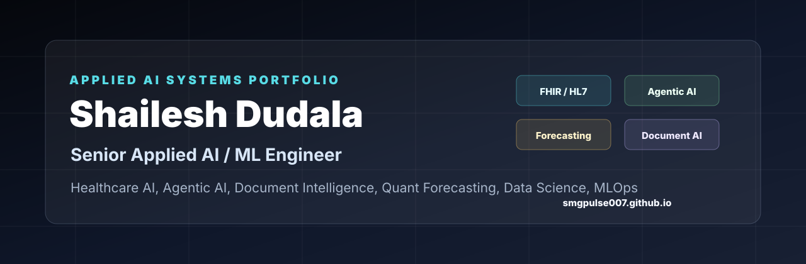

# Shailesh Dudala

**Senior Applied AI / ML Engineer**

I build production-grade AI systems across healthcare, insurance, document intelligence, claims automation, agentic workflows, forecasting, and MLOps/LLMOps.

## Portfolio

**Start here: [shaileshdudala.com](https://shaileshdudala.com/)** — professional case studies, engineering decisions, public projects, and source evidence.

Portfolio structure:

- Healthcare and insurance AI: FHIR/HL7, claims automation, HEDIS, readmission, LOS, FWA analytics, and public-safe synthetic demos.
- Agentic AI, LLMOps, and document intelligence: local LLMs, RAG, OCR, activation steering, workflow state, validation gates, and review UX.
- Quant, forecasting, and research systems: AlphaQuant, sports forecasting/backtesting, calibration, research visualization, GPU planning, and data science foundations.

## Explore the work

| Project | What you can inspect or run |
|---|---|
| [Healthcare AI Awards](https://smgpulse007.github.io/healthcare-ai-awards/) · [source](https://github.com/smgpulse007/healthcare-ai-awards) | Two distinct team awards, official records, and a synthetic workflow explorer. This new showcase is separate from the historical winning apps. |
| [LLM Steering](https://github.com/smgpulse007/llm-steering) | Activation steering experiments, checked-in research artifacts, and a local console. The hosted console is a static preview; model runs require local setup. |
| [Meta Harness](https://github.com/smgpulse007/meta-harness) | Pre-1.0 CLI/MCP tooling for agent work, typed state, and proof records, with runnable examples. |
| [FreshTrack](https://github.com/smgpulse007/FreshTrackAIModule) | Local receipt OCR, editable extracted items, and JSON export. The quickstart includes a synthetic sample. |
| [ChatWithWiki](https://github.com/smgpulse007/ChatWithWiki_AzureML) | A local Wikipedia search and evidence CLI with revision citations and offline tests; Azure integration remains a separate path. |
| [AlphaQuant](https://github.com/smgpulse007/AlphaQuant) | An offline citation-coverage checker with a synthetic walkthrough. Coverage does not establish source truth; the public checkout has no frontend or trading integration. |

[Professional case studies](https://shaileshdudala.com/work/) · [Full project lab](https://shaileshdudala.com/lab/) · [Research](https://shaileshdudala.com/research/)

### Try the healthcare showcase

An authentic capture of the new public showcase, not of either original award-winning application. [Open the live demo](https://smgpulse007.github.io/healthcare-ai-awards/) or [run it locally](https://github.com/smgpulse007/healthcare-ai-awards#try-it-in-a-minute).

## Recognition

- **Let's Talk Doc — Transformative Impact in Healthcare Award**, Global HL7 AI Challenge (2025). Team recipient; [official award announcement](https://blog.hl7.org/hl7-international-announces-winners-of-global-ai-challenge-showcasing-standards-based-innovation-in-healthcare) and [recipient record](https://hl7news.hl7.org/2026/01/07/update-from-hq/).
- **Team Re-Admit — Best of ViVE: User's Choice Voting**, MeldRx Predictive AI in Healthcare with FHIR (2025). The [official submission](https://devpost.com/software/team-re-admit) credits Shailesh Dudala and William Laolagi.

[Recognition and supporting sources](https://shaileshdudala.com/recognition/)

## Links

[Portfolio](https://shaileshdudala.com/) | [Work](https://shaileshdudala.com/work/) | [Experience](https://shaileshdudala.com/experience/) | [Project Lab](https://shaileshdudala.com/lab/) | [LinkedIn](https://www.linkedin.com/in/ssdudala/)

## Safety Note

Public examples are synthetic, historical, or research/demo implementations with project-specific limitations. Professional case studies describe cleared systems and decisions; private employer source, patient data, and restricted training artifacts are not offered for download.
